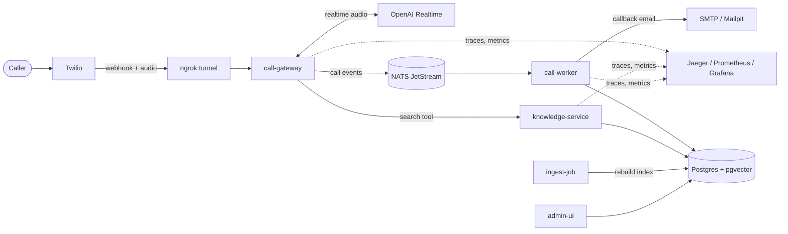

# AI Voice Helpdesk

An AI agent that answers your business phone. It speaks the caller's language, answers only from your own files, takes messages, and hands the call to a person when it can't help.

- **Multilingual:** replies in the language the caller speaks (built and tested for Albanian, English and German).
- **Grounded:** answers come from your `knowledge/` files (`.md`, `.txt`, `.csv`, `.pdf`). If the files don't cover it, the agent says so instead of guessing.
- **Takes messages:** callback requests are emailed to you and shown in the admin page.
- **Human handoff:** if it can't help, or the AI fails mid-call, the caller is transferred to your phone.
- **Observable:** transcripts, per-call cost, traces, metrics and alerts out of the box.
- **Deployable:** Docker Compose for local use, a Helm chart for k3s, GitHub Actions with Trivy scanning for CI.

## Contents

- [Quick start](#quick-start)
- [How it fits together](#how-it-fits-together)
- [Run modes](#run-modes)
- [Real phone calls](#real-phone-calls)
- [Using your real business](#using-your-real-business)
- [Configuration](#configuration)
- [Troubleshooting](#troubleshooting)
- [Kubernetes](#kubernetes)
- [CI/CD](#cicd)
- [Development](#development)

## Quick start

You need Docker and Node 24 or newer. No accounts are required for the first run.

```powershell
npm install
npm run sim:up       # whole system with a fake AI
npm run sim:call     # a scripted call through every service
npm run sim:verify   # checks the call reached each service
```

Then open the admin page at <http://localhost:8082> (password `demo-password`) to see the call, its transcript and its cost. `npm run sim:down` stops everything.

## How it fits together



| Part | Job |
|---|---|
| `call-gateway` | Takes Twilio's webhook and bridges call audio straight to OpenAI. Audio never goes through the broker. |
| `knowledge-service` | Hybrid search over your files, in Postgres with pgvector. |
| `ingest-job` | Rebuilds the index from `knowledge/` and swaps it in atomically. |
| `call-worker` | Reads events from NATS JetStream, writes them to Postgres, emails callback messages. |
| `admin-ui` | Password-protected pages for calls, transcripts, messages and cost. |
| `tools/sim` | Fake OpenAI, fake Twilio, scripted caller and the browser phone. |
| `packages/*` | Shared code: `shared` (events, metrics, telemetry), `broker`, `db`, `knowledge`. |

**Database:** one PostgreSQL with the pgvector extension holds calls, transcripts, messages and the search index. It runs in Docker locally and should be a hosted Postgres in production.

**Failures are designed for:**
- If NATS is down, calls carry on and events queue in memory.
- If OpenAI or the gateway fails mid-call, the caller goes to `TRANSFER_NUMBER`.
- A message is only confirmed to the caller once the broker has stored it.
- A failed event retries, then moves to a dead-letter stream (`HELPDESK_DLQ`).

**Cost** is estimated per call from OpenAI's reported usage and the rates in `config/pricing.yaml`. Compare it with your OpenAI bill, and update the rates if they change.

## Run modes

| Mode | Command | You need | What it's for |
|---|---|---|---|
| Simulation | `npm run sim:up` | Docker | The whole system with a fake AI and a scripted caller. Free. |
| Browser phone | `npm run phone:up` | An OpenAI key | Talk to the real AI through your laptop mic. No phone number. |
| Real calls | `docker compose up` | OpenAI, Twilio and ngrok accounts | Real phone calls. |

### Simulation

Everything below runs on your own machine:

| Page | Address | Sign in |
|---|---|---|
| Test phone: type a conversation | <http://localhost:9000> | |
| Admin: calls, transcripts, messages, cost | <http://localhost:8082> | `demo-password` |
| Grafana: dashboard and alerts | <http://localhost:3000> | `admin` / `admin` |
| Jaeger: one trace per call | <http://localhost:16686> | |
| Mailpit: callback emails | <http://localhost:8025> | |
| Prometheus: raw metrics | <http://localhost:9090> | |

The fake AI follows a simple script, so this tests the system around the AI and not the AI itself. Its answers do come from your real knowledge files, but it matches on spelling only, so a question in one language won't find an answer written in another.

### Browser phone

Real AI, no phone number. Copy `.env.example` to `.env`, add your OpenAI key, and set an admin password:

```powershell
npm run admin:hash -- "a password of your choice"
```

Put the output in `ADMIN_PASSWORD_HASH`, and any 32 or more random characters in `ADMIN_SESSION_SECRET`. Then:

```powershell
npm run phone:up
```

Open <http://localhost:9000>, allow the microphone and start a call. This is the cheapest way to judge the voice and the Albanian before you pay for a phone number. `npm run phone:down` stops it.

## Real phone calls

### 1. Get these ready

| You need | Where to get it |
|---|---|
| OpenAI API key on a paid tier | [platform.openai.com](https://platform.openai.com/api-keys) (the free tier can't use the Realtime API) |
| Twilio account and a voice number | [console.twilio.com](https://console.twilio.com) (Phone Numbers > Buy a number) |
| ngrok auth token and free static domain | [dashboard.ngrok.com](https://dashboard.ngrok.com) |

A Twilio free trial works for testing, but only phones you've verified in Twilio can call the number. Check Voice Geographic Permissions if you'll transfer calls abroad.

### 2. Fill in `.env`

Copy `.env.example` to `.env` and fill it in. It's ignored by git, so your keys stay on your machine. `TRANSFER_NUMBER` is your own phone, not the Twilio number.

### 3. Start it

```powershell
docker compose up --build
```

### 4. Point your Twilio number at it

In the Twilio Console, open **Phone Numbers > Active numbers > your number**. Under **Voice Configuration**, set:

- **A call comes in:** Webhook
- **URL:** `https://YOUR_NGROK_DOMAIN/incoming-call`
- **HTTP:** POST

Save, then call the number.

### What to test

| Test | What should happen |
|---|---|
| Call the number | The agent greets you in Albanian and says it's an AI |
| Speak English, German and **Albanian** | It replies in the language you're speaking |
| Talk over it mid-sentence | It stops straight away and listens |
| Ask about prices or opening hours | It answers from the knowledge files |
| Ask something the files don't cover | It says it doesn't know, and offers a person or a message |
| Leave a message | An email arrives (in Mailpit, unless you set `SMTP_URL`) |
| Ask for a person | It says it's connecting you, then your phone rings |

Forged requests should be refused. This should print `403`:

```powershell
curl.exe -s -o NUL -w "%{http_code}" -X POST https://YOUR_NGROK_DOMAIN/incoming-call -d "CallSid=fake"
```

**Judge the Albanian carefully.** OpenAI doesn't publish a supported language list for this model. The admin page shows what it heard and said. If it's weak, set `REALTIME_MODEL=gpt-realtime-2.1` in `.env`, which costs about 3x more for audio.

**Note the `signedUrl` value** in the `media stream signature verified` log line on your first real call. Twilio's docs don't say which URL form it signs, and the gateway accepts each likely form until that's known.

**Known behaviour:** speaking over the greeting cuts it off, including the AI notice.

## Using your real business

1. Edit `config/business.yaml` for the name, description, languages and greeting.
2. Replace the files in `knowledge/` with your own (`.md`, `.txt`, `.csv` or `.pdf`). A scanned PDF has no text and will stop the job with an error, so run OCR on it first.
3. Run `docker compose run --rm ingest` to rebuild the index, then `docker compose restart call-gateway`.
4. Put real caller questions in `knowledge/eval/questions.yaml`, including ones the files can't answer, and run `npm run eval:rag`. Raise `SEARCH_MIN_SIMILARITY` if it answers things it shouldn't, and lower it if it misses things it should find.

The sample business is fictional (Demo Auto Service).

## Configuration

Settings live in `.env` (see `.env.example` for the full list).

| Setting | What it does |
|---|---|
| `OPENAI_API_KEY` | Key for the Realtime API and embeddings |
| `TWILIO_AUTH_TOKEN` | Used to verify that webhooks really come from Twilio |
| `NGROK_AUTHTOKEN`, `NGROK_DOMAIN` | Tunnel to your machine (domain only, no `https://`) |
| `TRANSFER_NUMBER` | Your phone, where calls are handed to a person |
| `REALTIME_MODEL` | Voice model; a stronger one costs more |
| `VAD_THRESHOLD`, `VAD_SILENCE_DURATION_MS` | How sensitive the agent is to noise and pauses |
| `SEARCH_MIN_SIMILARITY` | How close a knowledge match must be to count as found |
| `SMTP_URL`, `NOTIFY_EMAIL_TO`, `NOTIFY_EMAIL_FROM` | Where callback emails go (Mailpit by default) |
| `ADMIN_PASSWORD_HASH`, `ADMIN_SESSION_SECRET` | Admin page login |

## Troubleshooting

Logs: `docker compose logs -f call-gateway`.

| What you see | Likely cause |
|---|---|
| The call says "an application error has occurred" | The webhook failed. Check `NGROK_DOMAIN` and `TWILIO_AUTH_TOKEN`. Requests are visible at <http://localhost:4040>. |
| `rejected media stream: bad signature` | Twilio signed a URL form we didn't expect. Check the log line and add that form in `twilioSignature.ts`. |
| Your phone rings instead of the agent answering | OpenAI failed, so the call fell back to you. Look for `AI session failed` or `session rejected`. |
| Noise on the line interrupts the agent | Raise `VAD_THRESHOLD`, for example to `0.7`. |
| The agent cuts in while you pause | Raise `VAD_SILENCE_DURATION_MS`, for example to `800`. |
| Your phone never rings on a transfer | Check Voice Geographic Permissions in Twilio. |
| knowledge-service stays unhealthy | Nothing is indexed yet, or the embedding model changed. Run `docker compose run --rm ingest`. |
| A message shows "Email not sent" | Check `SMTP_URL` and the call-worker logs. It retries, then moves the event to the `HELPDESK_DLQ` stream. |

## Kubernetes

The Helm chart is in `deploy/helm/helpdesk`. To test it on a local k3s cluster, with no accounts:

```bash
bash deploy/k3d/up.sh
```

For a real k3s server:

1. Run `kubectl apply -f deploy/k3s/traefik-config.yaml` once, so Traefik leaves long calls alone.
2. Create the `helpdesk-secrets` Secret (its keys are listed in `values.yaml`) and a TLS Secret named `helpdesk-tls`.
3. Set `DATABASE_URL` to a Postgres that has pgvector.

Only `call-gateway` is reachable from outside, and only on the two paths Twilio uses. Use `kubectl port-forward` for the rest, for example `kubectl -n helpdesk port-forward svc/admin-ui 8082`.

## CI/CD

`.github/workflows/ci.yml` runs on every pull request: lint, typecheck, tests against real Postgres and NATS, image builds, Trivy scans of images, code and manifests, and a simulated call through the whole system. HIGH and CRITICAL findings fail the build, apart from those with no fix available.

On `main` it pushes images to GHCR, tagged with the commit SHA. Deployment stays off until you set these in the repository:

| Kind | Name |
|---|---|
| Variables | `DEPLOY_ENABLED=true`, `PUBLIC_HOST`, `TRANSFER_NUMBER`, `NOTIFY_EMAIL_TO`, `NOTIFY_EMAIL_FROM` |
| Secrets | `KUBE_CONFIG` (base64), `TS_OAUTH_CLIENT_ID`, `TS_OAUTH_SECRET` |

CI reaches the cluster over Tailscale, so its API stays off the public internet.

## Development

```powershell
npm install
npm run check              # lint, typecheck and unit tests
npm run test:integration   # the same, plus real Postgres and NATS in Docker
```

The repo is an npm workspace: `packages/*`, `services/*` and `tools/*`. Node 24 or newer is required.
